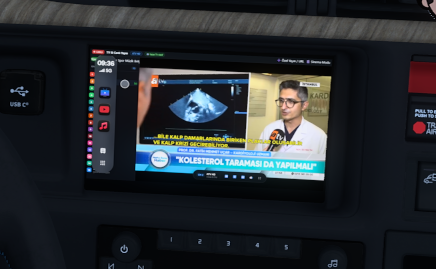
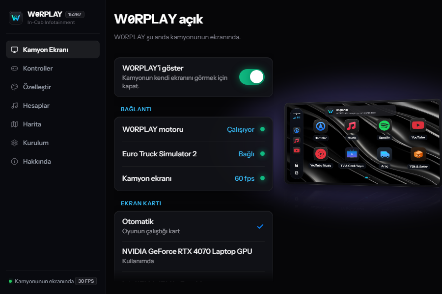
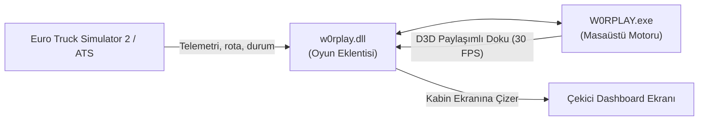

<p align="center"></p>

<h1 align="center">W0RPLAY</h1>

<p align="center">
  <b>Euro Truck Simulator 2 & American Truck Simulator için yeni nesil araç içi CarPlay ekranı.</b><br>
  Canlı TV, haritanız, rotanız, YouTube ve müzikleriniz doğrudan çekicinizin konsol ekranında.
</p>

<p align="center">
  <a href="https://github.com/w0rpsi/w0rplay/releases/latest"></a>
  
  
  <a href="LICENSE"></a>
  <a href="https://github.com/w0rpsi"></a>
</p>

<p align="center">
  <a href="#özellikler">Özellikler</a> ·
  <a href="#ekran-görüntüleri">Ekran Görüntüleri</a> ·
  <a href="#kurulum">Kurulum</a> ·
  <a href="#desteklenen-çekiciler">Desteklenen Çekiciler</a> ·
  <a href="#güncellemeler">Güncellemeler</a> ·
  <a href="#gizlilik">Gizlilik</a>
</p>

<br>

<p align="center">
  
</p>

W0RPLAY, Euro Truck Simulator 2 ve American Truck Simulator çekicilerinizin kendi dijital konsol ekranına akıllı telefon tarzı bir CarPlay arayüzü entegre eder. Oyununuzun gerçek yollarından üretilen harita rotası, Spotify, YouTube Music, YouTube ve canlı ulusal televizyon kanalları (ATV, TRT 1, TV8 vb.) tam kabin içinde yer alır. `Sol Alt` tuşuna basılı tutarak farenizle ekranı doğrudan kabin içinden kontrol edebilirsiniz.

---

## Ekran Görüntüleri

<table>
  <tr>
    <td width="50%" valign="top">
      
      <h4 align="center">Kabin İçi Canlı TV & CarPlay</h4>
      Çekicinizin konsolunda sinema modu ve canlı TV yayını deneyimi.
    </td>
    <td width="50%" valign="top">
      
      <h4 align="center">W0RPLAY Masaüstü Paneli</h4>
      Otomatik oyun tespiti (ETS2/ATS), harita oluşturucu ve ekran durumu.
    </td>
  </tr>
</table>

---

## Özellikler

* **📺 Canlı TV & HLS Akışları:** TRT 1, TV8, ATV, Now TV ve ulusal kanallarla canlı yayın desteği. Dilerseniz kendi özel m3u8 veya canlı yayın bağlantınızı da ekleyebilirsiniz.
* **⚡ Sabit 30 FPS Optimizasyonu:** Yenilenen kare hızlandırıcı ve paylaşımlı Direct3D doku belleği sayesinde oyun içi FPS drop yaşanmaz; akıcı 30 FPS deneyimi sunar.
* **🎵 Kesintisiz Medya & Müzik:** Spotify, YouTube Music, YouTube ve Apple Music desteği. Çekicinin motoru stop ettiğinde veya kontak kapalıyken bile müzik çalmaya devam eder.
* **🗺️ Oyundan Birebir Haritalar:** Oyunun kendi dosyalarından ve harita modlarından (ProMods vb.) otomatik harita vektörleri üretilir; adım adım dönüş kılavuzu ve GPS entegrasyonu sunar.
* **🚚 Çift Oyun Desteği:** Hem Euro Truck Simulator 2 hem de American Truck Simulator ile tam uyumludur.
* **🔄 Otomatik GitHub Güncelleyici:** Uygulama her açıldığında [w0rpsi/w0rplay](https://github.com/w0rpsi/w0rplay) deposundaki en güncel sürümü denetler; yeni bir build (örneğin `1b268`) yayınlandığında sizi uyarır.
* **🎨 Tema ve Özelleştirme:** İster Açık/Koyu mod, ister kendi duvar kağıtlarınız. Farlar açıldığında veya hava karardığında otomatik gece görünümü.

---

## Nasıl Çalışır?



W0RPLAY, masaüstünüzde bağımsız ve hafif bir arayüz motoru çalıştırır. `w0rplay.dll` eklentisi ise bu arayüzü GPU üzerinde paylaşımlı doku ile oyun içerisindeki çekicinizin orijinal ekran yüzeyine 30 FPS olarak yansıtır.

---

## Kurulum

1. [En Son Sürümü İndirin](https://github.com/w0rpsi/w0rplay/releases/latest) (`W0RPLAY-1b267.zip`).
2. Arşiv içerisindeki **`w0rplay.dll`** dosyasını oyununuzun eklenti klasörüne kopyalayın:
   * **ETS2 için:** `Euro Truck Simulator 2/bin/win_x64/plugins/w0rplay.dll`
   * **ATS için:** `American Truck Simulator/bin/win_x64/plugins/w0rplay.dll`
   *(Klasör yoksa `plugins` adıyla kendiniz oluşturabilirsiniz)*
3. **`W0RPLAY.exe`** uygulamasını başlatın. Masaüstü paneli oyununuzu otomatik olarak algılayacaktır.
4. Oyuna girin ve çekicinize geçin. Ekranı kullanmak için **`Sol Alt`** tuşuna basılı tutarak farenizle etkileşime geçin.

---

## Desteklenen Çekiciler

Gerçek hayatta CarPlay / dijital multimedya ekranı bulunan çekiciler desteklenmektedir:

* **Euro Truck Simulator 2:**
  * **DAF** XF ve XG / XG+ 2021 (ve Jasper DAF 2021)
  * **Scania** S ve R (7" ekran veya Smart Dash)
  * **Iveco** S-Way
  * **Renault** T (2024)
* **American Truck Simulator:**
  * **Freightliner** Cascadia
  * **Kenworth** T680 (Next Gen)
  * **Peterbilt** 579
  * **Volvo** VNL

---

## Güncellemeler

W0RPLAY, seri numaralı sürüm takibi kullanır (örn: `1b267`). Uygulamayı başlattığınızda GitHub API üzerinden en güncel sürüm taranır; yeni bir sürüm çıktığında masaüstü panelinde indirme bildirimi görüntülenir.

---

## Gizlilik

W0RPLAY hiçbir özel sunucuya, hesaba veya telemetri servisine veri göndermez.
* Spotify, YouTube ve diğer servis oturumlarınız yalnızca kendi yerel tarayıcı profilinizde saklanır.
* Harita verileriniz kendi bilgisayarınızda derlenir ve dışarı çıkmaz.
* Uygulama yalnızca GitHub API üzerinden sürüm güncellemesi kontrolü yapar.

---

## Kaynak Koddan Derleme

Geliştiriciler için kaynak koddan derleme adımları:

Gereksinimler: [Rust](https://rustup.rs) (stable) ve [Node.js](https://nodejs.org) 24+ (Windows 64-bit).

```sh
# Arayüz bağımlılıklarını kurma
npm install --prefix ui

# Geliştirme modunda çalıştırma
npm run dev --prefix ui

# Oyun eklentisini derleme
cargo build --release -p w0rplay-plugin
```

---

## Lisans

W0RPLAY, **GNU General Public License v3.0 (GPL-3.0)** kapsamında açık kaynaklıdır. Detaylar için [LICENSE](LICENSE) dosyasına bakabilirsiniz.

<sub>W0RPLAY bağımsız bir projedir; SCS Software, Apple, Spotify veya Google ile resmi bir bağı bulunmamaktadır. Tüm marka ve model isimleri uyumluluk belirtme amacıyla kullanılmıştır.</sub>
